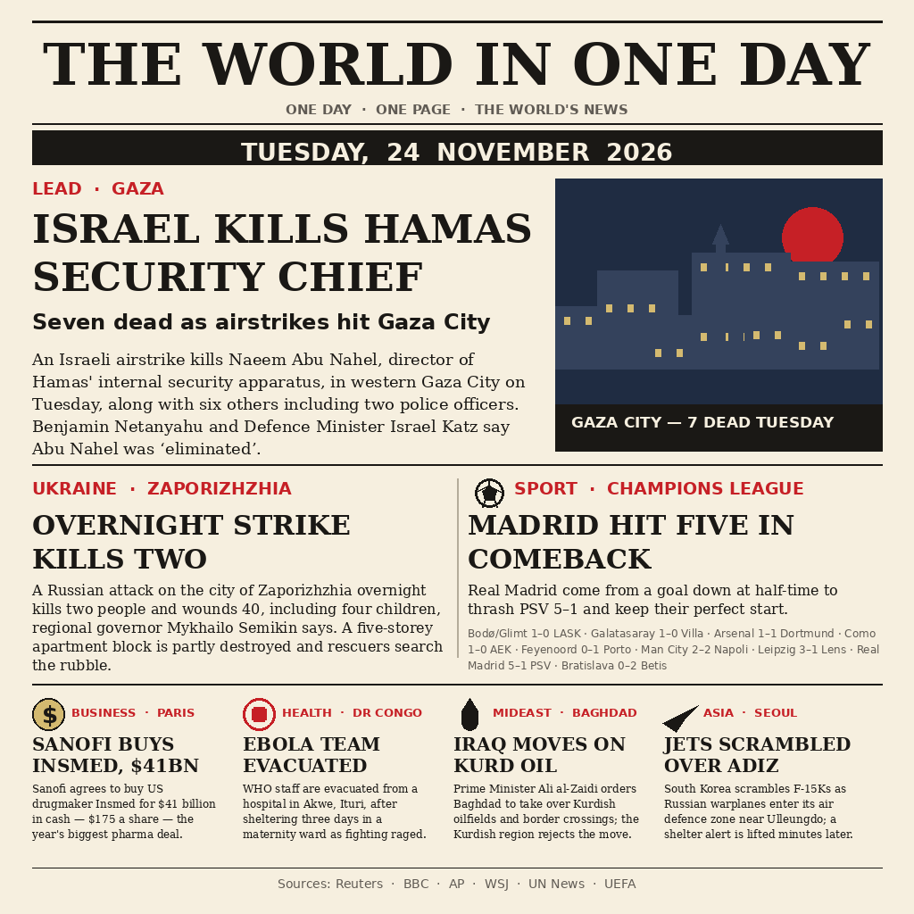

# makefun-news-image-20261124

[](https://make.fun/bounty/news-image-20261124)
[](https://make.fun/bounty/news-image-20261124)
[](https://make.fun/bounty/news-image-20261124)

Entry for the make.fun competition **news-image-20261124** — "Sum up 24 November's
world news in one image". The program draws one front page, *The World in One Day*,
for **Tuesday, 24 November 2026**.



## The day's stories

1. **LEAD · GAZA — "ISRAEL KILLS HAMAS SECURITY CHIEF"**
   An Israeli airstrike kills Naeem Abu Nahel, director of Hamas' internal
   security apparatus, in western Gaza City on Tuesday, along with six others
   including two police officers. Benjamin Netanyahu and Defence Minister
   Israel Katz say Abu Nahel was "eliminated". *(Reuters / BBC, 24 Nov 2026)*
2. **UKRAINE · ZAPORIZHZHIA — "OVERNIGHT STRIKE KILLS TWO"**
   A Russian attack on the city of Zaporizhzhia overnight kills two people and
   wounds 40, including four children, regional governor Mykhailo Semikin
   says. A five-storey apartment block is partly destroyed.
   *(Reuters / AP, 24 Nov 2026)*
3. **SPORT · CHAMPIONS LEAGUE — "MADRID HIT FIVE IN COMEBACK"**
   Real Madrid come from a goal down at half-time to thrash PSV 5–1 and keep
   their perfect start in the league phase. Arsenal are held 1–1 by Borussia
   Dortmund and Manchester City draw 2–2 with Napoli; Galatasaray edge Aston
   Villa 1–0. *(UEFA / Reuters, 24 Nov 2026)*
4. **ALSO TODAY**
   - **BUSINESS** — Sanofi agrees to buy US drugmaker Insmed for $41 billion
     in cash — $175 a share — the year's biggest pharma deal.
     *(Sanofi / WSJ, 24 Nov 2026)*
   - **HEALTH** — WHO staff are evacuated from a hospital in Akwe, Ituri,
     after sheltering three days in a maternity ward as fighting raged around
     the Ebola response. *(UN News, 24 Nov 2026)*
   - **MIDEAST** — Prime Minister Ali al-Zaidi orders Baghdad to take over
     Kurdish-controlled oilfields and border crossings after an oil-smuggling
     probe; the Kurdish region rejects the move. *(Reuters, 24 Nov 2026)*
   - **ASIA** — South Korea scrambles F-15Ks as Russian warplanes enter its
     air defence zone and near Ulleungdo island; a shelter alert is lifted
     minutes later. *(Reuters / WSJ, 24 Nov 2026)*

Stories deliberately left out because their date is not 24 November: Nvidia
reinstating Jensen Huang (Mon 23 Nov), the ICJ's Myanmar genocide ruling
(Thu 19 Nov), the UK's Myanmar sanctions (Mon 23 Nov), NATO's space press
conference (Mon 23 Nov), the COP31 collapse (Sun 22 Nov), the US losing
measles elimination status (17 Nov), the Grok lawsuits filed by Virginia and
Oregon (Mon 23 Nov), the Germany–Ukraine DELTA signing (Mon 23 Nov), and the
Benghazi corvette strike (Mon 23 Nov).

## How it is built

- `draw_entry.py` draws `entry.png` (1024×1024, Pillow only, no network).
  Two runs write byte-identical files.
- `main.py` (standard library only) copies `entry.png` to the output directory
  the grader provides.

## Run it

```sh
python3 draw_entry.py
mkdir -p out && MAKEFUN_OUTPUT_DIR=out python3 main.py
```
